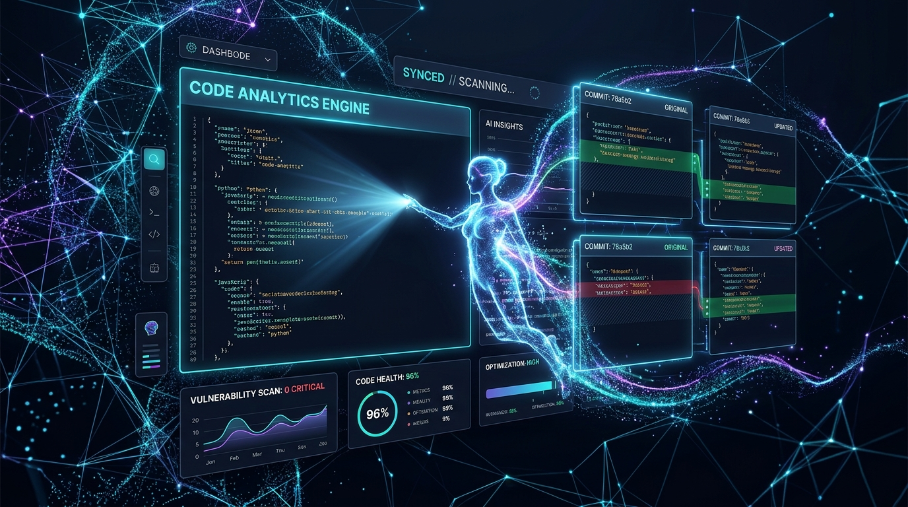

<div align="center">



# ⚡ DevPulse AI
### Autonomous Pull Request Code Health & Intelligent Security Audit Studio

[](LICENSE)
[](https://github.com/Vijay-1710)
[](#tech-stack)
[](#architecture)

<p align="center">
  <strong>Transforming pull request reviews from a development bottleneck into an instant, high-confidence superpower.</strong>
</p>

</div>

---

## 🚀 Overview

**DevPulse AI** is a state-of-the-art interactive code governance and vulnerability remediation studio built for hackathons, engineering teams, and open-source contributors. 

Manual code reviews often miss subtle credential leaks, quadratic Big-O regressions, or unescaped query parameters. DevPulse AI analyzes pull requests across three dimensions in parallel:
1. **Security Vulnerability Matrix:** Static AST detection for OWASP Top 10 flaws, hardcoded credentials (`CWE-798`), and injection vectors (`CWE-89`).
2. **Algorithmic Complexity & Benchmark Profiler:** Catches nested loop performance regressions before they hit production clusters.
3. **Self-Healing Auto-Patch Engine:** Automatically writes remediation patches and updates your diffs with a single click.

---

## ✨ Key Features

| Feature | Description |
| :--- | :--- |
| **🛡️ Real-Time Vulnerability Matrix** | Categorizes CVEs by severity (Critical, High, Medium) with explicit CWE tags and code pointers. |
| **⚡ Big-O Algorithmic Profiler** | Visual benchmark comparison showing execution latency ($O(N^2)$ to $O(N \log N)$) and heap impact. |
| **🔄 Interactive Diff Viewer** | Unified and Split diff views with syntax-aware line highlighting and inline AI commentary. |
| **🪄 1-Click AI Auto-Patch** | Instantly remediates vulnerable code patterns and re-calculates project health scores in real time. |
| **📝 PR Summary Generator** | Auto-generates clean, structured GitHub Markdown descriptions with test plans and changelogs. |
| **🧪 Live Code Sandbox** | Interactive playground to paste custom snippets, test regex/AST rules, and audit code live. |
| **🔊 Cybernetic Audio Synthesizer** | Procedurally generated Web Audio API sound effects for clicks, scans, and patch achievements. |
| **📊 Export Station** | Download comprehensive audit artifacts in GitHub Markdown (`.md`) or machine-readable JSON. |

---

## 🎨 Design Philosophy & Aesthetics

- **Deep Obsidian & Neon Accents:** Carefully balanced dark palette (`#080b12`, `#0f1422`) with vibrant Cyan (`#06b6d4`), Neon Violet (`#8b5cf6`), and Emerald (`#10b981`).
- **Glassmorphic Depth:** Subtle backdrop blur filters, radiant background gradients, and high-contrast typography.
- **Micro-Interactions:** SVG circular score ring, animated radar pulse, smooth diff transitions, and custom toast notifications.

---

## 🛠️ Architecture & Tech Stack

DevPulse AI is engineered with zero runtime bloat. It requires **no external build toolchain** or heavy node dependencies to preview and run:

- **Structure:** Semantic HTML5 with complete ARIA accessibility and unique identifiers.
- **Styling:** Pure Vanilla CSS3 utilizing CSS Custom Properties, flexbox, CSS Grid, and hardware-accelerated animations.
- **Logic:** Modular ES6+ JavaScript handling state transitions, diff generation, AST heuristics, and audio synthesis.
- **Audio:** Native Web Audio API synthesizer for procedural sound generation.

```
devpulse-ai/
├── assets/
│   ├── banner.jpg      # High-resolution platform preview banner
│   └── logo.jpg        # Vector-styled cybernetic brand logo
├── index.html          # Main application interface and audit workspace
├── style.css           # Glassmorphism design system & code diff styling
├── app.js              # Client state, diff engine, heuristics & audio
├── package.json        # NPM scripts and project metadata
├── .gitignore          # Standard repository exclusions
└── README.md           # Documentation & setup guide
```

---

## 🏁 Quick Start

### 1. Direct Browser Launch
Simply open `index.html` in any modern web browser:
```bash
# Windows PowerShell
Start-Process "index.html"
```

### 2. Local Development Server
Or start a fast local development server:
```bash
npm start
# Server active at http://localhost:3000
```

---

## 🚢 Publishing to Your GitHub Account

Follow these steps to push this project to your GitHub account (`Vijay-1710`):

1. **Create a new repository on GitHub:**
   - Go to [github.com/new](https://github.com/new).
   - Name your repository: `devpulse-ai`.
   - Choose **Public** and leave "Add a README" **unchecked** (we already created one!).
   - Click **Create repository**.

2. **Link and push from your terminal:**
   ```bash
   cd C:\Users\VIJAY\.gemini\antigravity-ide\scratch\devpulse-ai
   git remote add origin https://github.com/Vijay-1710/devpulse-ai.git
   git branch -M main
   git push -u origin main
   ```

3. **Deploy to Vercel or GitHub Pages (Optional):**
   - Import your `Vijay-1710/devpulse-ai` repository directly on [Vercel](https://vercel.com) or enable GitHub Pages in your repository settings under **Settings > Pages**.

---

## 📄 License

Distributed under the MIT License. See `LICENSE` for more information.

---

<div align="center">
  <sub>Created with 💙 for high-impact open source & hackathon engineering by <a href="https://github.com/Vijay-1710">Vijay-1710</a></sub>
</div>
